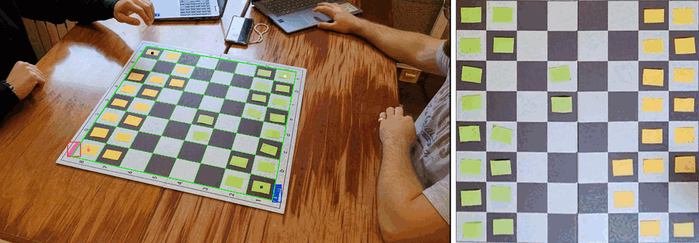
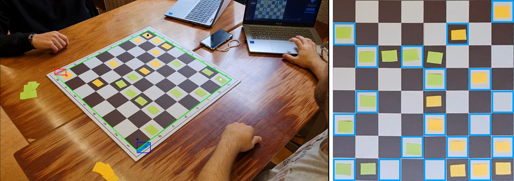

# Chess Computer Vision

Suivre une partie d'échecs filmée dont les pièces sont remplacées par des marqueurs identiques (un modèle par camp, des post-it par exemple) et reconstituer l'état du plateau : calibration par homographie et détection des cases occupées en vision classique (OpenCV), puis identification du type de chaque pièce inconnue à partir de ses seuls déplacements, le plus tôt possible et même si l'observation commence en cours de partie.



*Sortie du pipeline (`src/calibration.py`, `src/detection.py`) sur les images de `data/sample_frames/` : contour du plateau et coins (vert), stickers d'orientation rose et bleu, grille projetée par l'homographie, et à droite la vue de dessus redressée.*

## Problème

Une caméra, fixe ou tenue à la main, filme une partie d'échecs. Les pièces sont remplacées par deux types de marqueurs identiques (un pour les blancs, un pour les noirs, par exemple des post-it jaunes et verts) : la forme de la pièce n'est donc pas visible. Le système doit :

1. retrouver le plateau dans chaque image, quel que soit l'angle de vue ;
2. savoir quelles cases sont occupées, et par quel camp ;
3. en déduire **quelle pièce** se trouve où, uniquement à partir de la manière dont chaque marqueur se déplace (un déplacement en L est un cavalier, etc.), sans connaître la position de départ ni l'historique : l'observation peut commencer au coup 9 ou au coup 40, avec des prises et des promotions déjà jouées ;
4. exporter l'historique des états du plateau au format JSON.

C'est le sujet du projet du cours ELEN-0016 *Computer Vision* de l'Université de Liège (2024-2025).

## Approche

```
vidéo ──► calibration ──► vue de dessus ──► occupation des cases ──► pièces inconnues ──► game.json
          (coins +        (homographie,      (HSV + contours,          (types possibles de
           stickers)       800×800 px)        par case)                 chaque marqueur, CSP)
```

| Étape | Fichier | Ce que fait le code |
|---|---|---|
| Calibration | `src/calibration.py` | Détection des deux stickers d'orientation (rose et bleu) par seuillage HSV et morphologie ; détection des 7×7 coins internes avec `cv2.findChessboardCorners` puis `findChessboardCornersSB` en repli (trois prétraitements successifs) ; raffinement sub-pixel (`cornerSubPix`) ; extrapolation des coins externes et ordonnancement a1, a8, h8, h1 grâce aux stickers. |
| Redressement | `src/detection.py` | Homographie entre les quatre coins détectés et un plateau idéal, puis `warpPerspective` vers une vue de dessus de 800×800 px (cases de 100×100 px). |
| Détection | `src/detection.py` | Pour chaque case : masque HSV des couleurs saturées (seuils différents pour les cases claires et foncées, correction en cas de surexposition), `findContours`, case déclarée occupée si un contour dépasse 1 300 px². |
| Pièces inconnues | `src/piece_inference.py` (2026) | Chaque marqueur est une variable dont le domaine est l'ensemble des types encore possibles ; chaque coup observé et des règles vraies dans toute position légale retirent des types (détails ci-dessous). Remplace la logique d'origine `src/logic.py` (2024), qui supposait une partie observée depuis le début. |
| Export | `src/output_json.py`, `src/process.py` | Boucle vidéo : une analyse toutes les 50 images, nouvelle tentative 10 images plus loin si la calibration échoue ; écriture des coups et des états du plateau dans un JSON. |



*Détecteur d'origine (v1), `python src/demo.py data/sample_frames/frame05.png` : à droite, les cases qu'il considère comme occupées, avec ses erreurs (cases claires vides retenues, marqueurs manqués). La v2 corrige ces erreurs sur les images de test (voir « Résultats »).*

## Résultats

Le rapport du projet ([`docs/report.pdf`](docs/report.pdf), section 3) ne donne **pas de mesure chiffrée** (ni précision, ni vitesse). Il indique que :

- chaque module a été testé séparément et fonctionne : calibration, détection, déduction des pièces (testée sur les états de partie annotés de l'étape 1), export JSON ;
- la détection se trompe sur certaines cases, surtout celles éloignées de la caméra, où les marqueurs paraissent moins colorés ;
- l'enchaînement complet des modules, en particulier la sortie JSON, n'était pas entièrement fonctionnel au moment du rapport.

Vérifications faites lors de la remise en forme du dépôt (novembre 2026, OpenCV 4.10, NumPy 1.26) :

- tous les fichiers Python compilent, et les modules de `src/` s'importent sans erreur ;
- sur les 12 images de `data/sample_frames/`, la calibration aboutit sur 6 et échoue sur les 6 autres (plateau ou stickers non trouvés) ;
- `src/process.py` s'exécute de bout en bout sur une courte vidéo construite à partir de ces images et écrit un JSON. Comme ces images ne forment pas une partie continue, aucun coup n'est reconnu : cela vérifie seulement que la chaîne tourne, pas qu'elle est juste.

Les vidéos des parties ne sont pas dans le dépôt, donc la reconnaissance des pièces sur une vraie partie n'a pas pu être rejouée ici.

### Mesures et améliorations (novembre 2026)

Pour chiffrer le pipeline, une petite vérité terrain a été annotée à la main ([`data/ground_truth/`](data/ground_truth/README.md)) : coins du plateau et contenu des 64 cases (vide, camp blanc, camp noir) des 11 images distinctes de `data/sample_frames/`, réparties en 5 images de développement (réglages, entraînement) et 6 images de test, lues une seule fois pour la mesure finale. Le pipeline d'origine (v1) a été mesuré tel quel, puis comparé à une version 2 :

- **calibration** (`src/robust_calibration.py`) : effacement des post-it par inpainting avant `findChessboardCornersSB`, recherche multi-échelle, acceptation d'un sous-damier quand une main cache le plateau (position choisie en vérifiant l'alternance clair/foncé), stickers cherchés près des coins trouvés et un seul sticker suffisant ;
- **occupation** (`src/occupancy.py`) : 4 mesures par case (écart de couleur centre/bordure, saturation, contours, contraste) et une régression logistique entraînée sur les 311 cases du développement (`training/train_occupancy.py`, 10 s) ; un seuil adaptatif sans apprentissage reste disponible ;
- **affichage** : l'homographie de la grille dessinée dans `src/detection.py` est corrigée (elle était appliquée dans le mauvais sens) ;
- **logique de jeu d'origine** (`src/replay.py`, `logic.py` inchangé) : roque et prise en passant traités, pièce prise retirée du dictionnaire, conversion « état précédent + coup » attendue par `pieces_recognition`. Elle sert désormais de référence pour le nouveau moteur (section suivante).

| Mesure (images de test, 377 cases visibles) | Résultat |
|---|---|
| Calibration réussie (4 coins à moins de 3 % du côté, bonne orientation), v1 d'origine | 3/6 |
| Calibration réussie (4 coins à moins de 3 % du côté, bonne orientation), v2 | **6/6** |
| Calibration sur 60 vues synthétiques des images de test (rotation, perspective, échelle, flou, JPEG), v1 d'origine | 28,3 % |
| Calibration sur 60 vues synthétiques des images de test (rotation, perspective, échelle, flou, JPEG), v2 | **88,3 %** |
| Exactitude d'occupation par case, bout en bout, v1 d'origine | 35,5 % |
| Exactitude d'occupation par case, bout en bout, v2 | **100 %** |
| Exactitude d'occupation avec les coins annotés (détecteur seul), v1 d'origine | 65,5 % |
| Exactitude d'occupation avec les coins annotés (détecteur seul), v2 | **100 %** |
| Exactitude vide / blanc / noir, coins annotés, v1 d'origine | non calculée |
| Exactitude vide / blanc / noir, coins annotés, v2 | 99,7 % |

Chiffres écrits par `python training/evaluate.py` dans [`training/metrics.json`](training/metrics.json). Sur les images de développement, le seuil adaptatif et la régression logistique font jeu égal (99,7 %) ; sur le test, la régression fait mieux grâce à `frame20` (vis métalliques peu saturées : 52/64 avec le seuil, 64/64 avec la régression). La démo utilise la régression. Ces chiffres portent sur 6 images, dont plusieurs proches des images de développement : ils montrent l'ordre de grandeur du gain, pas une précision garantie sur d'autres plateaux. La calibration v2 a été conçue en voyant les 12 images ; les vues synthétiques en donnent un contrôle partiel.

## Identifier les pièces inconnues à partir des seuls coups (novembre 2026)

**Le problème.** Les marqueurs d'un camp sont identiques : la vision ne donne que l'occupation des cases (blanc, noir, vide). Il faut retrouver le type de chaque marqueur au fil de la partie, en le moins de coups observés possible, sans jamais se servir de la case de départ ni supposer la position initiale : l'observation peut commencer au coup 9 ou au coup 40, avec un nombre quelconque de marqueurs (prises et promotions possibles), sans droits de roque ni historique.

**Ce qui se fait.** Le cadre naturel est celui des jeux à information imparfaite dont l'inconnue est l'identité des pièces (Stratego, cartes) : l'état caché est un problème de satisfaction de contraintes (CSP) dont les solutions sont tous les états encore logiquement possibles, éventuellement complété par une estimation de probabilités ([Morenville et Piette, 2025](https://arxiv.org/abs/2507.19263)). Les contraintes de dénombrement viennent de l'analyse rétrograde des échecs (au plus 8 pions, pièces en surplus expliquées par des promotions ; [Wikipédia](https://en.wikipedia.org/wiki/Retrograde_analysis)). Aucune bibliothèque ne fait ce suivi pour les échecs : il est réimplémenté ici, sans python-chess (GPL-3.0) ; `src/chessrules.py` (règles minimales, FEN, PGN) ne sert qu'à produire les positions réelles pour l'évaluation et la démo.

**L'approche** (`src/piece_inference.py`, incrémentale, sans dépendance) :

- *géométrie de chaque coup* : cavalier, roi, glissement orthogonal ou diagonal sans saut (les cases intermédiaires sont visibles), pion (avance d'une case, double pas depuis sa 2e rangée, prise en diagonale, en avant seulement), prise en passant (motif à 3 cases : les deux marqueurs sont des pions), roque (motif à 4 cases : roi et tour, et les cases traversées ne sont pas attaquées), promotion (un pion possible qui atteint la dernière rangée devient une nouvelle variable, liée à l'ancienne) ;
- *règles valables dans toute position* : exactement un roi par camp ; au plus 16 marqueurs ; jamais de pion sur la 1re ou la 8e rangée ; pions + pièces en surplus ≤ 8 (dames au-delà de 1, tours et cavaliers au-delà de 2, fous au-delà de 1 **par couleur de case**) ; 32 marqueurs présents = aucune prise, donc aucune promotion ; une pièce prise n'est jamais le roi ;
- *légalité* : après son coup, le camp qui vient de jouer n'est pas en échec (rois non adjacents compris). Tant que le roi n'est pas identifié, cela donne des contraintes binaires « si ce marqueur est le roi, celui-là n'est pas d'un type qui l'attaquerait » ;
- *propagation* : cohérence d'arc sur ces contraintes, et cohérence exacte sur le dénombrement par un couplage biparti marqueurs / emplacements {roi, dame, 2 tours, 2 cavaliers, fou clair, fou foncé}, appliqué à l'instant présent et à chaque instant passé où l'ensemble des marqueurs a changé (les types d'une variable ne changent pas). Une observation incohérente (erreur de vision, coup manqué) remet tout à zéro plutôt que de risquer une fausse certitude ;
- *certain / probable* : un marqueur dont le domaine n'a plus qu'un type est **identifié avec certitude** ; c'est une preuve, jamais un pari. Pour les autres, une régression logistique (`models/piece_prior.json`, entraînée sur 4 000 parties lichess CC0 distinctes du test) classe les types restants : c'est **le plus probable**. Elle tient compte de la case actuelle du marqueur, de ses déplacements et du nombre de marqueurs ; elle ne sert jamais aux certitudes.

La propagation n'est pas complète : une cohérence par singleton (essayer chaque type et propager) n'ajoute qu'environ 1 point d'identification sur un échantillon, pour un temps de calcul environ 100 fois plus long ; elle n'est pas retenue.

Résultats sur les 2 000 parties lichess de test (section `piece_identification` de `training/metrics.json`) : part des marqueurs présents **identifiés avec certitude** après N demi-coups observés.

| Début de l'observation, méthode | Identifiés après 0 → 10 → 20 → 40 → 60 demi-coups (certitudes fausses, en marqueurs × demi-coups) |
|---|---|
| coup 1 (2 000 extraits), nouveau moteur | 50,0 % → 56,4 % → 65,5 % → 85,3 % → 95,7 % (fausses : 0 sur 1 888 442) |
| coup 1 (2 000 extraits), ancienne logique | 0,0 % → 7,2 % → 15,2 % → 27,8 % → 45,0 % (fausses : 42 sur 472 122) |
| coup 9 (1 914 extraits), nouveau moteur | 0,1 % → 10,4 % → 19,1 % → 33,2 % → 46,3 % (fausses : 0 sur 368 732) |
| coup 9 (1 914 extraits), ancienne logique | 0,0 % → 9,6 % → 15,7 % → 27,2 % → 37,8 % (fausses : 74 sur 306 129) |
| coup 15 (1 795 extraits), nouveau moteur | 0,0 % → 7,0 % → 10,7 % → 17,8 % → 33,7 % (fausses : 0 sur 140 070) |
| coup 15 (1 795 extraits), ancienne logique | 0,0 % → 6,9 % → 11,8 % → 20,1 % → 24,7 % (fausses : 88 sur 147 250) |
| coup 25 (1 386 extraits), nouveau moteur | 0,0 % → 4,8 % → 8,2 % → 21,6 % → 50,9 % (fausses : 0 sur 57 062) |
| coup 25 (1 386 extraits), ancienne logique | 0,0 % → 4,9 % → 8,3 % → 11,3 % → 17,4 % (fausses : 186 sur 40 919) |
| coup 40 (584 extraits), nouveau moteur | 0,1 % → 5,9 % → 17,7 % → 48,0 % → 63,7 % (fausses : 0 sur 22 064) |
| coup 40 (584 extraits), ancienne logique | 0,0 % → 3,6 % → 5,7 % → 11,2 % → 17,0 % (fausses : 119 sur 6 978) |

Pour l'ancienne logique, « identifiés » compte tous les types qu'elle affiche, faux compris : elle suppose les effectifs de départ (8 pions, 2 fous, 1 dame…), ce qui la fait parfois conclure plus tôt, mais à tort dès qu'il y a eu des prises ou des promotions avant l'observation.

Nombre médian de demi-coups observés avant identification certaine, par type (tous départs confondus ; « non atteinte » : moins de la moitié des marqueurs de ce type identifiés dans l'extrait) :

| Type (marqueurs), méthode | Identifiés dans l'extrait ; médiane sur tous ; médiane parmi les identifiés |
|---|---|
| pion (103 707), nouveau | 37,6 % ; non atteinte ; 0 |
| pion (103 707), ancienne | 7,4 % ; non atteinte ; 43 |
| cavalier (22 059), nouveau | 83,3 % ; 11 ; 8 |
| cavalier (22 059), ancienne | 83,2 % ; 11 ; 8 |
| fou (22 554), nouveau | 23,3 % ; non atteinte ; 30 |
| fou (22 554), ancienne | 16,6 % ; non atteinte ; 30 |
| tour (28 013), nouveau | 36,1 % ; non atteinte ; 24 |
| tour (28 013), ancienne | 35,3 % ; non atteinte ; 22 |
| dame (12 707), nouveau | 56,0 % ; 44 ; 23 |
| dame (12 707), ancienne | 50,1 % ; 60 ; 24 |
| roi (15 358), nouveau | 56,1 % ; 45 ; 20 |
| roi (15 358), ancienne | 41,6 % ; non atteinte ; 17 |

- **Erreurs** : 0 identification certaine fausse sur 2 476 370 (nouveau moteur) ; 509 types faux sur 973 398 affichés (ancienne logique). Remises à zéro après observation incohérente : 0.
- **Le plus probable** (a priori) : exact pour 89,2 % des marqueurs non identifiés, 93,1 % de tous les marqueurs (certitudes comprises). Au tout début d'une observation au coup 1, l'a priori reconnaît les pièces à leur case actuelle : c'est une statistique, pas une certitude, et elle ne vaut plus après des échanges.
- **Temps par demi-coup** (propagation + a priori, Python pur, un cœur ; mesuré pendant qu'un autre entraînement occupait la machine, donc pessimiste) : moyenne 3,492 ms, médiane 1,059 ms, 95e centile 15,394 ms, maximum 317,28 ms ; ancienne logique : moyenne 0,148 ms.

Les 2 parties annotées du dépôt (part identifiée avec certitude après 20 demi-coups et à la fin de l'extrait ; certitudes fausses) :

| Partie, début, méthode | Identifiés après 20 demi-coups ; à la fin de l'extrait ; certitudes fausses |
|---|---|
| gameLR_fix, coup 1, nouveau | 74,2 % ; 85,7 % ; 0 |
| gameLR_fix, coup 1, ancienne | 22,6 % ; 14,3 % ; 0 |
| gameLR_fix, coup 9, nouveau | 32,0 % ; 85,7 % ; 0 |
| gameLR_fix, coup 9, ancienne | 12,0 % ; 7,1 % ; 0 |
| gameLR_fix, coup 15, nouveau | 4,8 % ; 7,1 % ; 0 |
| gameLR_fix, coup 15, ancienne | 4,8 % ; 7,1 % ; 0 |
| gameLR_fix, coup 25, nouveau | – ; 7,1 % ; 0 |
| gameLR_fix, coup 25, ancienne | – ; 7,1 % ; 0 |
| gameLR_mov, coup 1, nouveau | 78,1 % ; 100,0 % ; 0 |
| gameLR_mov, coup 1, ancienne | 25,0 % ; 83,3 % ; 0 |
| gameLR_mov, coup 9, nouveau | 42,9 % ; 66,7 % ; 0 |
| gameLR_mov, coup 9, ancienne | 17,9 % ; 38,9 % ; 0 |
| gameLR_mov, coup 15, nouveau | 9,1 % ; 16,7 % ; 0 |
| gameLR_mov, coup 15, ancienne | 9,1 % ; 27,8 % ; 0 |
| gameLR_mov, coup 25, nouveau | 11,1 % ; 11,1 % ; 0 |
| gameLR_mov, coup 25, ancienne | 11,1 % ; 11,1 % ; 0 |


Protocole complet et commandes : [`training/README.md`](training/README.md).

## Démo en ligne

**[elliotbch.github.io/chess_computer_vision](https://elliotbch.github.io/chess_computer_vision/)**

La démo existe en deux versions qui exécutent le même code Python : une version statique en ligne (dossier [`site/`](site/), GitHub Pages), où tout le calcul se fait dans le navigateur du visiteur avec [Pyodide](https://pyodide.org) 0.27.7 dans un Web Worker, sans aucun envoi de données ; et une version API ([`demo/`](demo/README.md), FastAPI, Docker) à lancer en local.

- **rejeu** : les 2 parties annotées, 3 parties célèbres du domaine public, ou votre PGN / FEN + coups ; curseur « commencer l'observation au coup N » ; sur l'échiquier, chaque marqueur avec son type s'il est identifié avec certitude, sinon le type le plus probable et les candidats restants ; moment où chaque pièce est identifiée ; courbe « pièces identifiées / demi-coups observés » comparée à l'ancienne logique ;
- **vision** : une photo d'exemple ou la vôtre, avec les coins détectés, la grille, la vue de dessus et les cases occupées avec le camp de chaque marqueur. En ligne, OpenCV est le paquet `opencv-python` 4.10 de Pyodide (11,4 Mo), chargé seulement à la première photo.

Version statique : le site charge Pyodide et NumPy (environ 8,5 Mo transférés, 17 Mo une fois décompressés ; environ 3 s au premier chargement sur une connexion rapide, puis gardés dans le cache du navigateur), puis OpenCV à la première photo (11,4 Mo, environ 2 s). Un demi-coup prend 2 à 4 ms en moyenne dans le navigateur (médiane 1 à 2 ms), une photo 0,3 à 1,7 s. Les modules de `src/` sont copiés tels quels dans `site/py/`, et les fonctions de présentation de `demo/app.py` sont extraites telles quelles (`site/py/demo_glue.py`) :

```bash
python site/sync_site.py                 # après toute modification de src/ ou de demo/app.py
python site/tests/test_sync.py           # vérifie que les copies sont identiques aux originaux
python3 -m http.server 8000 -d site      # http://localhost:8000 ; page de fidélité : /tests/parity.html
```

La page `site/tests/parity.html` compare les réponses du site à celles de la démo FastAPI (`site/tests/reference.json`, écrit par `site/tests/make_reference.py`) : identifications coup par coup des 5 parties d'exemple observées à partir des coups 1, 9 et 25, deux parties importées, et occupation des 6 photos d'exemple. Tout est identique. Pour les photos d'exemple, le site analyse les pixels exacts que décode la démo API (PNG sans perte) : le décodeur JPEG d'OpenCV-Pyodide arrondit quelques pixels autrement, ce qui suffit à changer une case ambiguë de `frame07` (cachée par une main). Une photo JPEG importée peut donc, rarement, donner une case différente de la version API.

Version API :

```bash
python demo/sync_pipeline.py
cd demo && pip install -r requirements.txt
MODEL_PATH=../models/occupancy_logreg.json PRIOR_PATH=../models/piece_prior.json uvicorn app:app --port 7860   # http://localhost:7860
```

## Stack

Python 3 · OpenCV (calibration, homographie, segmentation HSV, contours) · NumPy · Matplotlib et Pillow (rendu 2D des états de partie dans les notebooks d'annotation).

Pas de deep learning : vision classique, raisonnement par contraintes pour les pièces inconnues, et deux petites régressions logistiques (occupation des cases ; a priori des types), entraînées avec scikit-learn et appliquées sans lui. Règles des échecs réimplémentées (`src/chessrules.py`) : python-chess (GPL-3.0) n'est pas utilisé.

## Structure du dépôt

```
src/                     pipeline final (version utilisée pour le challenge en classe)
  process.py             point d'entrée vidéo → JSON
  calibration.py         stickers, coins du plateau, homographie
  detection.py           vue de dessus et occupation des cases
  logic.py               déduction du type de pièce d'origine (2024, référence)
  piece_inference.py     identification des pièces inconnues (CSP incrémental, a priori optionnel)
  chessrules.py          règles minimales, FEN et PGN (évaluation et démo seulement)
  output_json.py         construction du JSON de sortie
  demo.py                démo sur une image fixe (visualisation, pipeline v1)
  robust_calibration.py  calibration v2 (inpainting, sous-damier, stickers)
  occupancy.py           occupation des cases v2 (mesures par case, seuil adaptatif ou régression)
  replay.py              rejeu d'une partie avec logic.py (roque, prise en passant, prises)
training/                occupation (train_occupancy, evaluate), pièces inconnues (train_prior,
                         evaluate_inference, inference_data), metrics.json
tests/                   tests du moteur d'identification
data/lichess/            parties lichess CC0 (non versionnées, voir training/README.md)
data/famous_games/       3 parties célèbres du domaine public (PGN), exemples de la démo
demo/                    démo web, version API (FastAPI) et son Dockerfile
site/                    démo web, version statique (GitHub Pages, Pyodide), copies de src/ dans site/py/
data/sample_frames/      12 images extraites des vidéos, pour tester sans les vidéos
data/ground_truth/       vérité terrain annotée (coins, occupation des cases)
docs/report.pdf          rapport de 2 pages (groupe 09)
assets/                  images du README
archive/                 étapes intermédiaires du projet, conservées pour l'historique
  step1_annotation/      annotation des parties (notebooks, PGN, JSON des états réels)
  step2_calibration/     rendu de l'étape « calibration »
  step3_recognition/     rendu de l'étape « reconnaissance », avec ses variantes
  challenge/             script de test du JSON utilisé pendant le challenge
```

`archive/` n'est pas maintenu. `recognition.py` et `final_code.py` dans `archive/step3_recognition/` importent un module `detect_move` qui n'a jamais été versionné ; ils ne se lancent donc pas en l'état.

## Installation et exécution

```bash
git clone https://github.com/elliotbch/chess_computer_vision.git
cd chess_computer_vision
python -m venv .venv && source .venv/bin/activate
pip install -r requirements.txt
```

Le code a été vérifié avec Python 3.11, `opencv-python` 4.10 et NumPy 1.26. Avec OpenCV 5.0 et NumPy 2.x, la calibration plante (la forme du tableau renvoyé par `cornerSubPix` diffère), d'où les bornes de `requirements.txt`.

Démo sur une image (sans vidéo) :

```bash
python src/demo.py data/sample_frames/frame05.png -o demo_frame05.png
```

Pipeline complet sur une vidéo (non fournie, à placer par exemple dans `videos/`) :

```bash
python src/process.py videos/ma_partie.mp4 --start 0 --output game.json
```

La caméra doit voir les deux stickers d'orientation (rose et bleu) collés en bordure du plateau, comme sur les images d'exemple.

## Limites

- **Évaluation limitée.** Le rapport ne donnait aucun chiffre ; les mesures ajoutées en 2026 portent sur 11 images seulement (6 en test), faute de vidéos.
- **Réglages manuels.** Les seuils HSV, l'aire minimale et les seuils de luminosité ont été ajustés à la main sur les vidéos du projet. Sur d'autres images, la détection produit des faux positifs (cases claires sous une lumière chaude) et des oublis ; les marqueurs peu saturés, comme les vis métalliques de `data/sample_frames/frame20.png`, ne sont pas détectés.
- **Calibration.** La v1 demande les 7×7 coins internes et les deux stickers (échec sur 6 images sur 12). La v2 tolère une main ou un sticker manquant, mais échoue encore sur 12 % des vues synthétiques (angles rasants, petites images).
- **Traitement hors ligne.** Le pipeline lit un fichier vidéo et n'analyse qu'une image sur 50. Il ne traite pas un flux en direct.
- **Pièces inconnues.** La certitude est rare tant que les pièces ne bougent pas : un marqueur immobile peut être n'importe quel type compatible avec les dénombrements, et un pion qui avance d'une case pourrait aussi être une tour, une dame ou le roi. En milieu de partie, sans connaître le nombre de promotions, les fous et tours sont rarement certains ; « le plus probable » prend alors le relais, sans garantie. Le moteur suppose des observations justes : une erreur de vision provoque une remise à zéro (perte de l'acquis), pas une correction.
- **Pas de réalité augmentée.** La tâche bonus du sujet (remplacer les marqueurs par l'image des pièces dans la vidéo) n'a pas été réalisée. Le seul rendu des pièces est le plateau 2D généré à partir des annotations (`archive/step1_annotation`).

## Équipe et crédits

Projet réalisé en groupe de trois (groupe 09). Contributions telles que décrites dans le rapport :

- **Elliot Bouchy** : organisation générale du code, calibration de base et avancée, détection des pièces et des mouvements.
- **Adrien Martins** : organisation générale, script de calibration de base, toute la logique de reconnaissance des pièces.
- **Léa Rion** : organisation générale, calibration avancée, redressement des images, détection des pièces.

## Contexte

Projet du cours ELEN-0016 *Computer Vision* (Pr M. Van Droogenbroeck, A. Cioppa et R. Vandeghen), Université de Liège, année 2024-2025. Rendus entre octobre et décembre 2024, avec un challenge final en classe. Les énoncés du cours ne sont pas redistribués ici.

Licence : Apache 2.0, voir [`LICENSE`](LICENSE).
